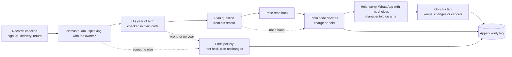

# Settled

Paytm asks before it charges.

Settled phones a shopkeeper before the first Soundbox rent is taken, checks it's really him, and asks him, in his own language, whether he agreed to the plan. If he says yes twice, the rent runs and his yes goes in the log. If he says no, isn't sure, or someone else answers, the money is held and a person follows up. An AI model sorts what he said. Plain code decides what happens to the money.

A prototype built for Paytm. Paytm's side (charges, holds, tickets and texts) is mocked.

## Shopkeepers get charged rent they never agreed to

1.64 crore merchants pay Paytm for a device subscription (Q2 FY27). A salesman signs a shop up for a Soundbox, the price gets said out loud once, and the rent comes out of the shop's settlements from then on. Public complaints from 2024 to 2026 show what happens when that one conversation goes wrong: ₹125 a month taken for months, ₹950 for a box never ordered, rent kept after the box was returned.

Paytm's own AI Soundbox already answers merchants' questions about money coming in. Settled covers the other direction: it asks before money goes out, and it leaves a record of the answer.

## How a call goes

Version 2 changed the call after feedback from the hackathon mentors.



Before any call, Settled reads the shop's records. A box that was never delivered isn't charged and the shop isn't called. A missing record puts the rent on hold for a person to check.

If the records are in order, it calls, greets him by name and asks if it's speaking with him, all in one line. Nothing is recorded: his voice goes to speech-to-text and is thrown away, and the log keeps the words. Then it asks the year he was born, said plainly as a check that it's him. [`settled/year.py`](settled/year.py) reads the year out of his reply, as "1978", "१९७८", "unnees sau athattar", "उन्नीस सौ अठहत्तर", "san athattar", "78" or "nineteen seventy eight", and compares it with the record. The AI never sees it. "Ek minute" or a pause get "take your time" instead of "I didn't get that", and the year is asked at most 3 times in all. If he won't say ("nahi bataunga"), that's a fair answer: Settled says that's fine and nothing changes. A reply with no year in it goes to the AI only for what he meant, and plain code picks the line: "aap kaun ho", "kyun chahiye" or another question gets who's calling and why, a scared "तू मेरे पैसे लूटेगा?" gets "we're not asking for any money, OTP or PIN", and both get the year asked again, within the same 3 asks. An angry reply ends calmly, like a refusal. An unclear answer to the name question gets it asked once more. If someone else picks up, or the year still doesn't match, Settled says goodbye politely and nothing about his plan changes: it says Paytm calls him again this evening and books that call. Every such ending, a refusal and a cut call too, sends his registered number an SMS with a Call me now button, so he can ring back himself. A call he starts runs the same name and year checks.

Only then comes the plan question, built from his record in [`data/shops.json`](data/shops.json): "The Paytm Soundbox put in your shop on 24 October has a rent of ₹125 a month from 1 November. Did you take this plan?" Shopkeepers rarely know the salesman's name, so it stays in the records and the manager's alert, not the question. A clear haan gets the price read back ("So ₹125 every month from 1 November. Shall I confirm it?"), and only a second haan charges.

Anything else holds the rent. Settled says sorry, tells him nothing will be taken, and sends him a WhatsApp with what his sign-up form says and three choices: keep the plan, switch to the cheaper one, or cancel and return the box. On a na, the salesman's manager gets a WhatsApp with what he said. Settled never offers to take the box back on the call.

Every step writes a row to the log: what was said, what was heard, how the AI sorted it, which rule fired, and what Paytm would do.

## The money rules live in code

The AI's only job is to sort a reply into one of five kinds and say who's speaking. [`settled/rules.py`](settled/rules.py) turns that into an outcome. The one thing it does straight from the AI's reading is charge, after two clear haans from the verified owner.

| What happened | Outcome |
|---|---|
| Box never delivered | Not charged, no call |
| Sign-up, delivery or return record missing | Held, a person checks |
| Someone else answers, or he doesn't say he's the owner when asked twice | Ends politely, held, plan unchanged |
| Wrong year or no year after 3 asks, or he won't say | Ends politely, held, plan unchanged |
| He's busy and asks for a call later, at any step | Ends politely, nothing changed, an SMS says Paytm calls back, a retry call is booked |
| He hangs up, the line cuts, silence after the line is said again, or the board restarts mid-call | Nothing changes, his open choices stay, an SMS says the call cut, a retry call is booked |
| Haan, then haan again on the read-back | Charged at the signed plan |
| Haan, then anything else on the read-back | Held, WhatsApp with his choices |
| Na | Held, manager told, WhatsApp with his choices |
| Unsure, a question, or no answer | Held, WhatsApp with his choices |
| He taps a choice in the WhatsApp | Kept, switched or cancelled, as he chose |

A few things hold these together:

- Cancelling, changing a plan or booking a pickup only happens through his own tap (`POST /api/consent/<id>/<choice>`, in [`settled/paytm_mock.py`](settled/paytm_mock.py)). A second tap on the same message is refused.
- A shop's rent is settled once a round: one charge or one cancel, checked in the same database write that makes it. After that, Settled won't call the shop again in that round. A WhatsApp's choices keep working while the rent is undecided in that round. A later call that never verifies him (a son, a wrong year, silence) leaves them as they are. Once a charge or his tap settles the rent, or a new round starts, a tap on an old message gets 409, "this link has expired".
- `POST /api/call/<shop>/hangup` is him hanging up, at any step. It answers `{"ok": true}`.
- `POST /api/call/<shop>/callback` is him tapping Call me now on the SMS, or calling the number back. It starts a call like Start, logged with a "calling" row whose rule starts with "callback".
- A demo round stands for a fresh rent cycle, so the next group can see every shop again. `POST /api/round/new` starts one and answers `{"round": n}`. It writes a row to the log and changes nothing before it.
- If the reply comes from someone else (a son, a worker, the salesman), [`ai/reader.py`](ai/reader.py) turns it into unsure, so a yes from them never counts.
- A lone "hmm" reads as no answer, never haan. On a live call, a reply that reads as no answer, or silence, gets the line said once more before it counts.
- If the AI call fails or returns anything outside the expected JSON, the reply reads as unsure, and unsure holds.

## It speaks 11 languages, with no translation step

Settled speaks Hindi, Bengali, Gujarati, Kannada, Malayalam, Marathi, Odia, Punjabi, Tamil, Telugu and English: every language that both Sarvam's speech-to-text and text-to-speech take.

The ten lines Settled says are written out in each language's own script in [`voice/script.py`](voice/script.py). Bulbul speaks them, Saaras transcribes his reply in the same language, and the reader gets that transcript as is, Tamil script or Hinglish or a mix. The prompt ([`ai/prompt_hi.md`](ai/prompt_hi.md)) tells the model the agent's line in English and his reply in whatever he said, so nothing gets translated on the way in.

The Hindi lines are hand-written. The other ten are machine-written and need a native speaker to check them before a real shop hears them.

## The stack is small on purpose

- Speech to text: Sarvam Saaras v4 (`saaras:v4`)
- Speech: Sarvam Bulbul v3 (`bulbul:v3`)
- Sorting the reply: `sarvam-105b-conversations`, temperature 0, JSON output
- Server and logic: Python standard library only, no packages to install
- Log: SQLite, with triggers that abort any update or delete on the log and messages tables
- Board: plain HTML and script with bundled fonts, no framework, no CDN

## Tested on 97 simulated shopkeepers

[`bench/cases.json`](bench/cases.json) holds 144 typed calls, each with the lines a shopkeeper says, a label for each line, and the outcome it should end in. They cover honest yeses, flat nos, nos with a reason, a yes with a "but", questions, silence, a lone "hmm", the salesman or a relative answering, wrong, missing and refused years, scared, angry and "who are you" replies, years said in Hindi words, "san" and two digits, English words or Devanagari, busy replies, hang-ups, second calls and demo rounds, his taps on the WhatsApp choices, and cases in all 11 languages. [`bench/run.py`](bench/run.py) plays each call through the real flow and scores the outcome in code.

With the Sarvam model sorting every reply:

| Run | Outcomes matched | Honest yeses charged | Charged after na or unsure |
|---|---|---|---|
| [Version 2: 16 consent, identity and plan cases picked](bench/results/ai-reader-v2-2026-10-31.txt) | 13 of the 14 run before the spend cap | 2/2 | 0 |
| [Version 1: 62 cases](bench/results/ai-reader-2026-10-31.txt) | 62/62 | 13/13 | 0 |
| [Version 1: re-run after a prompt change](bench/results/ai-reader-langs-2026-10-31.txt) | 27 of 27 run (stopped at the spend cap, 35 cases) | 4/4 | 0 |
| [Version 1: Marathi, Kannada, Gujarati](bench/results/ai-reader-mr-kn-gu-2026-10-31.txt) | 8/8 | 2/2 | 0 |

In the version 2 run nothing was charged without a verified owner, and the AI caused no cancel, plan change or pickup. The one miss was "haan bolo, main unki wife hoon" (yes, go on, I'm his wife) at the owner question. The model read it as the shopkeeper being unsure, not as someone else, so the call ended as "not confirmed" instead of "someone else". Either way it ended politely with nothing changed. Replies took 0.29 seconds on average.

In the 62-case run the model sorted 8 lines differently from their label. Five were Tamil, Telugu, Bengali, Kannada and Gujarati nos with a reason, read as unsure. Three were confused replies read as questions. All 8 calls still ended held, which is the point of keeping the money in code. The prompt was changed afterwards to keep a no with a reason as na, and the Marathi, Kannada and Gujarati run had no misreads.

The bench sends typed text to the model, and none of the cases come from real shopkeepers. Speech-to-text got its own run ([`bench/results/hindi-voice-2026-10-31.md`](bench/results/hindi-voice-2026-10-31.md)): 31 Hindi replies spoken by Bulbul in eight voices, plus a clip of shop noise with nobody speaking, sent through Saaras and the real flow, clean, with crowd noise down to 5 dB, and squeezed to phone quality. Before the fixes, a lone "hmm" got charged in every version. With the fixes, tested on a spare board, every full set came back 31/31 with nothing charged wrongly, and the median time from his reply to the decision was 0.68 to 0.70 seconds. Version 2 carries those fixes, with the no-answer line in the prompt worded narrower than the one tested.

Run it with the labels standing in for the AI (no key, no cost):

```
python bench/run.py --reader typed
```

With the Sarvam model, capped at a spend in rupees:

```
python bench/run.py --reader ai --cap 1
```

## Run it yourself

You need Python 3.10 or newer. There's nothing to install.

Put a Sarvam API key in `~/.config/keys.env` as one line:

```
SARVAM_API_KEY=your-key-here
```

On Windows the same file goes at `%USERPROFILE%\.config\keys.env`.

Then, from the repo root:

```
python dev.py
```

and open http://127.0.0.1:8080. `dev.py` runs `server.py` and restarts it when a Python file or the prompt changes, and `python server.py` runs it once. The main page is the call screen, with a live drawing of the call as it happens. The old board is at http://127.0.0.1:8080/classic.

There are three shops: Gupta Kirana and Sharma Store with full records, and Verma Dairy, whose box was never delivered. Start a call, pick a language, and hold to speak, or type a reply if there's no mic. The call screen shows his WhatsApp with the choices to tap.

It runs on Linux (Python 3.14) and on Windows 11 (Python 3.12), where the live demo takes real voice calls. On Windows use `python` or `py`. The server listens on 127.0.0.1 only. `BOARD_PORT` changes the port and `SETTLED_DB` changes where the log lives.

To try the rules with no key and no audio:

```
python try.py gupta haan haan
python try.py sharma na "usne ₹1 bola tha"
python try.py reset
```

## What's mocked, and what would connect to Paytm

There's no phone call. The board speaks Settled's line through the browser and listens on the browser mic.

[`settled/paytm_mock.py`](settled/paytm_mock.py) stands in for Paytm. Charging rent, holding it, opening a support ticket, booking a pickup, the WhatsApp to the salesman's manager and the SMS and WhatsApp to the shopkeeper are all written to the log and the messages table, and nothing is sent. His tap on a WhatsApp choice is a POST to the board. The shop records are mock records in [`data/shops.json`](data/shops.json): owner, sign-up form, salesman, device, delivery, return and payments. The names, price and dates in the spoken lines come from there.

For real use, each mock becomes a call to a Paytm system:

- the records come from Paytm's sign-up, delivery and return data
- the year of birth comes from his KYC record
- the call goes out from a Paytm line to the shop's bank-linked number
- charge and hold go to the settlement and payout side
- tickets, pickups, SMS and WhatsApp go to Paytm's existing support and messaging, and the choice buttons come back from WhatsApp

The rules, the reader and the log stay as they are.

## Project layout

```
settled/
├── server.py           board server, standard library http.server
├── dev.py              runs the server, restarts it on a change
├── try.py              type answers by hand, no AI
├── settled/
│   ├── rules.py        the money rules
│   ├── year.py         his year of birth, read in plain code
│   ├── flow.py         one shop from due to follow-up
│   ├── records.py      reads the shop records
│   ├── paytm_mock.py   Paytm's side, mocked, and his taps
│   ├── log.py          append-only SQLite log and messages
│   └── models.py       Shop, Plan, Answer, Decision
├── ai/
│   ├── reader.py       sorts a reply with the Sarvam model
│   └── prompt_hi.md    the reader's prompt
├── voice/
│   ├── script.py       the ten lines, in 11 languages
│   ├── sarvam.py       Bulbul and Saaras calls
│   ├── calls.py        one live call per shop
│   └── warm.py         says every line once so calls play from cache
├── board/
│   ├── proto/          the call screen, at /
│   └── index.html      the old board, at /classic
├── data/shops.json     three mock shop records and two plans
├── bench/
│   ├── cases.json      97 cases
│   ├── run.py          plays them through the flow
│   ├── hindi_voice.py  the Hindi voice run
│   ├── voice_run.py    replies as audio through a running board
│   ├── audio/          clips and the voice run's list
│   └── results/        saved runs
└── pitch/              the deck (PDF) and the demo video
```
