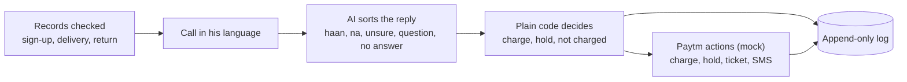

# Settled

Paytm asks before it charges.

Settled phones a shopkeeper before the first Soundbox rent is taken and asks him, in his own language, whether he agreed to the plan. If he says yes twice, the rent runs and his yes is saved. If he says no, isn't sure, or someone else answers, the money is held and a person follows up. An AI model sorts what he said. Plain code decides what happens to the money.

It's a prototype built for Paytm at the Paytm Build for India AI Hackathon in Delhi (October 2026). It isn't a Paytm product, and every Paytm action in it is a mock.

## Shopkeepers get charged rent they never agreed to

1.64 crore merchants pay Paytm for a device subscription (Q2 FY27). A salesman signs a shop up for a Soundbox, the price gets said out loud once, and the rent comes out of the shop's settlements from then on. Public complaints from 2024 to 2026 show what happens when that one conversation goes wrong: ₹125 a month taken for months, ₹950 for a box never ordered, rent kept after the box was returned.

Paytm's own AI Soundbox already answers merchants' questions about money coming in. Settled covers the other direction: it asks before money goes out, and it leaves a record of the answer.

## How a call goes



Before any call, Settled reads the shop's records. A box that was never delivered isn't charged and the shop isn't called. A missing record puts the rent on hold for a person to check.

If the records are in order, it asks: "₹125 a month for the Soundbox from 1 Nov. Did you take this plan? Haan or na?" A clear haan gets the price read back ("₹125 every month, from 1 Nov. Sure?"), and only a second haan charges. A na holds the rent, texts the shopkeeper that nothing will be taken, tells the salesman's manager what he said, and offers to explain the real plans or take the box back.

Every step writes a row to the log: what was said, what was heard, how the AI sorted it, which rule fired, and what Paytm would do.

## The money rules live in code

The AI's only job is to sort a reply into one of five kinds and say who's speaking. [`settled/rules.py`](settled/rules.py) turns that into an outcome, and nothing the model says can charge anyone on its own.

| What happened | Outcome |
|---|---|
| Box never delivered | Not charged, no call |
| Sign-up, delivery or return record missing | Held, a person checks |
| Haan, then haan again on the read-back | Charged at the signed plan |
| Haan, then anything else on the read-back | Held |
| Na | Held, manager told, plans or pickup offered |
| Na, then he picks a plan by name or price | Charged at that plan |
| Unsure, a question, or no answer | Held, a person follows up |
| Anyone but the shopkeeper answers | Held |

A few things hold these together, from [`ai/reader.py`](ai/reader.py):

- If the reply comes from someone else (a son, a worker, the salesman), the reader turns it into unsure, so a yes from them never counts.
- A plan pick only counts on the follow-up line and only with a haan.
- If the AI call fails or returns anything outside the expected JSON, the reply reads as unsure, and unsure holds.

## It speaks 11 languages, with no translation step

Settled speaks Hindi, Bengali, Gujarati, Kannada, Malayalam, Marathi, Odia, Punjabi, Tamil, Telugu and English: every language that both Sarvam's speech-to-text and text-to-speech take.

The three lines Settled says are written out in each language's own script in [`voice/script.py`](voice/script.py). Bulbul speaks them, Saaras transcribes his reply in the same language, and the reader gets that transcript as is, Tamil script or Hinglish or a mix. The prompt ([`ai/prompt_hi.md`](ai/prompt_hi.md)) tells the model the agent's line in English and his reply in whatever he said, so nothing gets translated on the way in.

The Hindi lines are hand-written. The other ten are machine-written and need a native speaker to check them before a real shop hears them.

## The stack is small on purpose

- Speech to text: Sarvam Saaras v4 (`saaras:v4`)
- Speech: Sarvam Bulbul v3 (`bulbul:v3`)
- Sorting the reply: `sarvam-105b-conversations`, temperature 0, JSON output
- Server and logic: Python standard library only, no packages to install
- Log: SQLite, with triggers that abort any update or delete on the log and messages tables
- Board: one plain HTML file with inline script and bundled fonts, no framework, no CDN

## Tested on 62 simulated shopkeepers

[`bench/cases.json`](bench/cases.json) holds 62 typed calls, each with the lines a shopkeeper says, a label for each line, and the outcome it should end in. They cover honest yeses, flat nos, nos with a reason, a yes with a "but", questions, silence, the salesman or a relative answering, and cases in Tamil, Telugu, Bengali, Marathi, Kannada and Gujarati alongside Hindi. [`bench/run.py`](bench/run.py) plays each call through the real flow and scores the outcome in code.

With the Sarvam model sorting every reply:

| Run | Outcomes matched | Honest yeses charged | Charged after na or unsure |
|---|---|---|---|
| [All 62 cases](bench/results/ai-reader-2026-10-31.txt) | 62/62 | 13/13 | 0 |
| [Re-run after a prompt change](bench/results/ai-reader-langs-2026-10-31.txt) | 27 of 27 run (stopped at the spend cap, 35 cases) | 4/4 | 0 |
| [Marathi, Kannada, Gujarati](bench/results/ai-reader-mr-kn-gu-2026-10-31.txt) | 8/8 | 2/2 | 0 |

In the 62-case run the model sorted 8 lines differently from their label. Five were Tamil, Telugu, Bengali, Kannada and Gujarati nos with a reason, read as unsure. Three were confused replies read as questions. All 8 calls still ended held, which is the point of keeping the money in code. The prompt was changed afterwards to keep a no with a reason as na, and the Marathi, Kannada and Gujarati run had no misreads. Replies took 0.30 to 0.33 seconds on average.

The bench sends typed text to the model. It doesn't test speech-to-text, and none of the cases come from real shopkeepers.

Run it with the labels standing in for the AI (no key, no cost):

```
python bench/run.py --reader typed
```

With the Sarvam model, capped at a spend in rupees:

```
python bench/run.py --reader ai --cap 1
```

## Run it yourself

You need Python 3.10 or newer. There's nothing to install.

Put a Sarvam API key in `~/.config/keys.env` as one line:

```
SARVAM_API_KEY=your-key-here
```

On Windows the same file goes at `%USERPROFILE%\.config\keys.env`.

Then, from the repo root:

```
python server.py
```

and open http://127.0.0.1:8080. The board shows three shops: Gupta Kirana and Sharma Store with full records, and Verma Dairy, whose box was never delivered. Start a call, pick a language, and hold to speak, or type a reply if there's no mic.

It's been run on Linux. On Windows use `python` or `py`, and the same steps should work. The server listens on 127.0.0.1 only. `BOARD_PORT` changes the port and `SETTLED_DB` changes where the log lives.

To try the rules with no key and no audio:

```
python try.py gupta haan haan
python try.py sharma na "usne ₹1 bola tha"
python try.py reset
```

## What's mocked, and what would connect to Paytm

There's no phone call. The board speaks Settled's line through the browser and listens on the browser mic.

[`settled/paytm_mock.py`](settled/paytm_mock.py) stands in for Paytm. Charging rent, holding it, opening a support ticket, booking a pickup, the WhatsApp to the salesman's manager and the SMS to the shopkeeper are all written to the log and the messages table, and nothing is sent. The shop records are [`data/shops.json`](data/shops.json), and the price and date in the spoken lines are fixed text.

For real use, each mock becomes a call to a Paytm system:

- the records come from Paytm's sign-up, delivery and return data
- the call goes out from a Paytm line to the shop's bank-linked number
- charge and hold go to the settlement and payout side
- tickets, pickups, SMS and WhatsApp go to Paytm's existing support and messaging

The rules, the reader and the log stay as they are.

## Project layout

```
settled/
├── server.py           board server, standard library http.server
├── try.py              type answers by hand, no AI
├── settled/
│   ├── rules.py        the money rules
│   ├── flow.py         one shop from due to follow-up
│   ├── records.py      reads the shop records
│   ├── paytm_mock.py   Paytm's side, mocked
│   ├── log.py          append-only SQLite log and messages
│   └── models.py       Shop, Plan, Answer, Decision
├── ai/
│   ├── reader.py       sorts a reply with the Sarvam model
│   └── prompt_hi.md    the reader's prompt
├── voice/
│   ├── script.py       the three lines, in 11 languages
│   ├── sarvam.py       Bulbul and Saaras calls
│   └── calls.py        one live call per shop
├── board/index.html    the board
├── data/shops.json     three demo shops and two plans
├── bench/              62 cases, the runner, saved results
└── pitch/              the deck (PDF) and the demo video
```
