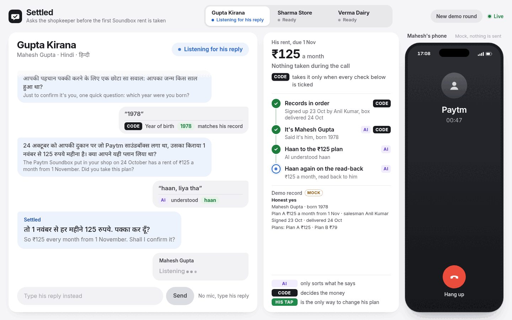
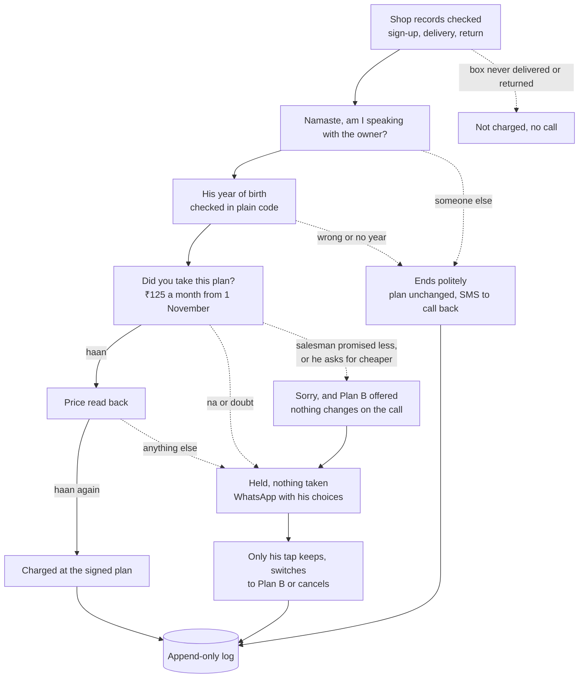

# Settled

Paytm asks before it charges.

Before the first Soundbox rent is taken, Settled calls the shopkeeper in his own language, checks it's really him, and asks if he agreed to the plan. An AI model sorts what he said. Plain code decides what happens to the money.

**[Live demo](https://settled-9bwm.onrender.com)** · **[Demo video](https://drive.google.com/file/d/1VbH5ZyHK1lq_nUxnUNisb4hXv_dbEItI/view)** · [Deck (PDF)](pitch/settled-deck.pdf)



A prototype built for Paytm at the Paytm Build for India AI Hackathon. Paytm's side (charges, holds, tickets and texts) is mocked.

## Shopkeepers get charged rent they never agreed to

1.64 crore merchants pay Paytm for a device subscription (Q2 FY27). A salesman signs a shop up for a Soundbox, the price gets said out loud once, and the rent comes out of the shop's settlements from then on.

Public complaints from 2024 to 2026 show what happens when that one conversation goes wrong:

- ₹125 a month taken for months
- ₹950 for a box never ordered
- rent kept after the box was returned

Paytm's own AI Soundbox already answers merchants' questions about money coming in. Settled covers the other direction: it asks before money goes out, and keeps a record of the answer.

## How a call goes

Version 2 changed the call after feedback from the hackathon mentors.



1. **Records first.** A box that was never delivered, has no delivery record, or was returned isn't charged and the shop isn't called. A missing sign-up or return record puts the rent on hold for a person.
2. **Is it him?** It greets him by name and asks if it's speaking with him, then asks the year he was born. [`settled/year.py`](settled/year.py) reads the year out of his reply ("1978", "१९७८", "unnees sau athattar", "san athattar", "78") and compares it with the record. The AI never sees it.
3. **The plan question**, built from his record in [`data/shops.json`](data/shops.json). A clear haan gets the price read back, and only a second haan charges.
4. **Anything else holds the rent.** He gets a WhatsApp with what his sign-up form says and his choices. If he says the salesman promised ₹1 or free, Settled says sorry and offers the cheaper Plan B. It offers Plan B too when he asks for something cheaper. A yes to Plan B on the call changes nothing: Plan B goes first in his WhatsApp, and only his tap starts it.
5. **Every step is logged:** what was said, what was heard, how the AI sorted it, which rule fired, and what Paytm would do.

Nothing is recorded. His voice goes to speech-to-text and is thrown away, and the log keeps the words.

<details>
<summary>The identity check in detail</summary>

- The year is read in plain code from digits, Devanagari, Hindi words, "san" and two digits, or English words ("nineteen seventy eight").
- "Ek minute" or a pause get "take your time" instead of "I didn't get that". The year is asked at most 3 times in all.
- If he won't say ("nahi bataunga"), that's a fair answer: Settled says that's fine and nothing changes.
- A reply with no year in it goes to the AI only for what he meant, and plain code picks the line. "Aap kaun ho" or "kyun chahiye" gets who's calling and why. A scared "तू मेरे पैसे लूटेगा?" gets "we're not asking for any money, OTP or PIN". Both get the year asked again, within the same 3 asks.
- An angry reply ends calmly, like a refusal. An unclear answer to the name question gets it asked once more.
- If whoever picks up says he's handing the phone over or asks to hold ("ek minute, bulata hoon"), Settled says it's on the line and asks for the owner once more.
- If someone else picks up, or the year still doesn't match, Settled says goodbye politely, says Paytm calls him again this evening, and books that call. His plan doesn't change.
- Every such ending, a refusal and a cut call too, sends his registered number an SMS with a Call me now button. A call he starts runs the same name and year checks.

</details>

## The AI sorts, the code decides

The AI sorts a reply into a kind (haan, na, unsure, question, no answer) and says who's speaking. It also notes what a question is about, what he says the salesman promised, and whether he's upset, and at the year question, what a reply with no year in it meant (wait, refuse, scared, angry and so on). Those pick what Settled says next: the answer to his question, the Plan B offer, the ending. [`settled/rules.py`](settled/rules.py) turns the kind into an outcome. The one thing it does straight from the AI's reading is charge, after two clear haans to the signed plan from the verified owner.

| What happened | Outcome |
|---|---|
| Box never delivered, no delivery record, or box returned | Not charged, no call |
| Sign-up or return record missing | Held, a person checks |
| Someone else answers, or wrong or no year | Ends politely, held, plan unchanged |
| He's busy, hangs up, or the line cuts | Nothing changes, SMS, a retry call is booked |
| Haan, then haan again on the read-back | Charged at the signed plan |
| Haan, then anything else on the read-back | Held, WhatsApp with his choices |
| A question about the price, start date or charge | Answered, the question asked again |
| A third question | Held, a person calls back |
| Na, unsure, or no answer | Held, WhatsApp with his choices |
| The salesman promised ₹1, free or a lower rent | Sorry, Plan B offered once |
| He asks for a cheaper plan | Plan B offered |
| Haan to Plan B | Held, Plan B first in his WhatsApp, nothing changes until he taps |
| He taps a choice in the WhatsApp | Kept, switched or cancelled, as he chose |

<details>
<summary>Every rule that holds these together</summary>

- Cancelling, changing a plan or booking a pickup only happens through his own tap (`POST /api/consent/<id>/<choice>`, in [`settled/paytm_mock.py`](settled/paytm_mock.py)). A second tap on the same message is refused.
- On a na, the salesman's manager gets a WhatsApp with what he said. Shopkeepers rarely know the salesman's name, so it stays in the records and the manager's alert, not the question. Settled never offers to take the box back on the call.
- A shop's rent is settled once a round: one charge or one cancel, checked in the same database write that makes it. After that, Settled won't call the shop again in that round.
- A WhatsApp's choices keep working while the rent is undecided in that round. A later call that never verifies him (a son, a wrong year, silence) leaves them as they are. Once a charge or his tap settles the rent, or a new round starts, a tap on an old message gets 409, "this link has expired".
- If the reply comes from someone else (a son, a worker, the salesman), [`ai/reader.py`](ai/reader.py) turns it into unsure, so a yes from them never counts.
- The prompt in [`ai/prompt_hi.md`](ai/prompt_hi.md) tells the model a lone "hmm" is no answer, never haan. On a live call, a reply that reads as no answer, or silence, gets the line said once more before it counts.
- If the AI call fails or returns anything outside the expected JSON, the reply reads as unsure, and unsure holds.
- If the board restarts mid-call, nothing changes, his open choices stay, and a retry call is booked.

</details>

## 11 languages, no translation step

| Part | How |
|---|---|
| Languages | Hindi, Bengali, Gujarati, Kannada, Malayalam, Marathi, Odia, Punjabi, Tamil, Telugu, English: every language both Sarvam's speech-to-text and text-to-speech take |
| What Settled says | Written out in each language's own script in [`voice/script.py`](voice/script.py), spoken by Bulbul |
| What he says | Transcribed by Saaras in the same language and handed to the reader as is, Tamil script, Hinglish or a mix |
| The prompt | [`ai/prompt_hi.md`](ai/prompt_hi.md) gives the model Settled's line in English and his reply in whatever he said |

The Hindi lines are hand-written. The other ten languages are machine-written and need a native speaker to check them before a real shop hears them.

## The stack is small on purpose

| Part | What it uses |
|---|---|
| Speech to text | Sarvam Saaras v4 (`saaras:v4`) |
| Speech | Sarvam Bulbul v3 (`bulbul:v3`) |
| Sorting the reply | `sarvam-105b-conversations`, temperature 0, JSON output |
| Server and logic | Python standard library only, nothing to install |
| Log | SQLite, with triggers that abort any update or delete on the log, messages and taps |
| Board | Plain HTML and script with bundled fonts, no framework, no CDN |

## Tested on typed calls

[`bench/cases.json`](bench/cases.json) holds typed calls, each with the lines a shopkeeper says, a label for each line, and the outcome it should end in. [`bench/run.py`](bench/run.py) plays each call through the real flow and scores the outcome in code. They cover honest yeses, flat nos, nos with a reason, questions, silence, a lone "hmm", the salesman or a relative answering, wrong, missing and refused years, a returned box, scared and angry replies, busy replies, hang-ups, second calls, his taps on the WhatsApp choices, and all 11 languages.

With the Sarvam model sorting every reply, across every saved run:

- **Nothing was charged after a na or unsure.**
- **Every honest yes was charged.**
- In the version 2 model run, made before the year-of-birth check replaced an app code, nothing was charged without a verified owner, and the AI caused no cancel, plan change or pickup.

On the code as it stands, with the labels standing in for the AI, [all 179 typed calls end as expected](bench/results/typed-v2-179-cases-2026-10-31.txt): 40/40 honest yeses charged, nothing charged after a na or unsure or without a verified owner. No model run covers this version yet.

<details>
<summary>Every saved run</summary>

| Run | Outcomes matched | Honest yeses charged | Charged after na or unsure |
|---|---|---|---|
| [Version 2 as it stands, labels standing in for the AI, all 179 cases](bench/results/typed-v2-179-cases-2026-10-31.txt) | 179/179 | 40/40 | 0 |
| [Version 2 earlier, labels standing in for the AI, the 144 cases saved then](bench/results/typed-v2-2026-10-31.txt) | 144/144 | 31/31 | 0 |
| [Version 2 before the year-of-birth check (an app code then), Sarvam model, 16 identity and plan cases picked](bench/results/ai-reader-v2-2026-10-31.txt) | 13 of the 14 run before the spend cap | 2/2 | 0 |
| [Version 1, Sarvam model, 62 cases](bench/results/ai-reader-2026-10-31.txt) | 62/62 | 13/13 | 0 |
| [Version 1, re-run after a prompt change](bench/results/ai-reader-langs-2026-10-31.txt) | 27 of the 27 run before the spend cap (35 picked) | 4/4 | 0 |
| [Version 1, Marathi, Kannada, Gujarati](bench/results/ai-reader-mr-kn-gu-2026-10-31.txt) | 8/8 | 2/2 | 0 |

The one miss in the version 2 model run, before the year-of-birth check, was "haan bolo, main unki wife hoon" (yes, go on, I'm his wife) at the owner question. The model read it as the shopkeeper being unsure, not as someone else, so the call ended as "not confirmed" instead of "someone else". Either way it ended politely with nothing changed. Replies took 0.29 seconds on average.

In the 62-case run the model sorted 8 lines differently from their label. Five were Tamil, Telugu, Bengali, Kannada and Gujarati nos with a reason, read as unsure. Three were confused replies read as questions. All 8 calls still ended held, which is why the money stays in code. The prompt was changed afterwards to keep a no with a reason as na, and the Marathi, Kannada and Gujarati run had no misreads.

</details>

<details>
<summary>The voice run: 31 Hindi replies through speech-to-text</summary>

The bench sends typed text to the model, and none of the cases come from real shopkeepers. Speech-to-text got its own run ([`bench/results/hindi-voice-2026-10-31.md`](bench/results/hindi-voice-2026-10-31.md)): 31 Hindi replies spoken by Bulbul in eight voices, plus a clip of shop noise with nobody speaking, sent through Saaras and the real flow. Each set ran clean, with crowd noise down to 5 dB, and squeezed to phone quality.

Before the fixes, a lone "hmm" got charged in every version. With the fixes, tested on a spare board, every full set came back 31/31 with nothing charged wrongly. The median time from his reply to the decision was 0.68 to 0.70 seconds. Version 2 carries those fixes, with the no-answer line in the prompt worded narrower than the one tested.

</details>

Run the bench with the labels standing in for the AI (no key, no cost):

```
python bench/run.py --reader typed
```

With the Sarvam model, capped at a spend in rupees:

```
python bench/run.py --reader ai --cap 1
```

## Run it yourself

You need Python 3.10 or newer. There's nothing to install.

1. Put a Sarvam API key in `~/.config/keys.env` as one line (on Windows, `%USERPROFILE%\.config\keys.env`):
   ```
   SARVAM_API_KEY=your-key-here
   ```
2. From the repo root, run `python dev.py` and open http://127.0.0.1:8080.
3. Pick a shop, pick a language, press Start call, and hold to speak. With no mic, type his reply instead. His phone on the right shows the WhatsApp choices to tap.

There are three shops: Gupta Kirana and Sharma Store with full records, and Verma Dairy, whose box was never delivered.

<details>
<summary>More ways to run it</summary>

- `dev.py` runs `server.py` and restarts it when a Python file or the prompt changes. `python server.py` runs it once.
- The old board is at http://127.0.0.1:8080/classic.
- It runs on Linux (Python 3.14) and on Windows 11 (Python 3.12). Calls are by voice through the browser, with no phone line. On Windows use `python` or `py`.
- The server listens on 127.0.0.1 by default, and on 0.0.0.0 when `PORT` is set. `BOARD_HOST` sets the address either way. `BOARD_PORT` or `PORT` changes the port (8080 by default), and `SETTLED_DB` changes where the log lives.

Try the rules with no key and no audio:

```
python try.py gupta haan haan
python try.py sharma na "usne ₹1 bola tha"
python try.py reset
```

</details>

<details>
<summary>The API the board uses</summary>

| Endpoint | What it does |
|---|---|
| `POST /api/consent/<id>/<choice>` | His tap on a WhatsApp choice. A second tap on the same message is refused, and a tap after the rent is settled gets 409, "this link has expired" |
| `POST /api/call/<shop>/hangup` | Him hanging up, at any step. Answers `{"ok": true}` |
| `POST /api/call/<shop>/callback` | Him tapping Call me now on the SMS, or calling back. Starts a call like Start, logged with a "calling" row whose rule starts with "callback" |
| `POST /api/round/new` | Starts a demo round, which stands for a fresh rent cycle so the next group can see every shop again. Answers `{"round": n}`, writes a row to the log and changes nothing before it |

</details>

## What's mocked, and what would connect to Paytm

There's no phone line. The board speaks Settled's line through the browser and listens on the browser mic.

[`settled/paytm_mock.py`](settled/paytm_mock.py) stands in for Paytm. Charging rent, holding it, opening a support ticket, booking a pickup, the WhatsApp to the salesman's manager and the SMS and WhatsApp to the shopkeeper are all written to the log and the messages table, and nothing is sent. The shop records in [`data/shops.json`](data/shops.json) are mock records.

| Mocked here | In real use |
|---|---|
| Shop records: owner, sign-up form, salesman, device, delivery, return, payments | Paytm's sign-up, delivery and return data |
| His year of birth | His KYC record |
| The call, through the browser | A Paytm line to the shop's bank-linked number |
| Charge and hold | The settlement and payout side |
| Tickets, pickups, SMS and WhatsApp | Paytm's existing support and messaging, with the choice buttons coming back from WhatsApp |

The rules, the reader and the log stay as they are.

<details>
<summary>Project layout</summary>

```
settled/
├── server.py           board server, standard library http.server
├── dev.py              runs the server, restarts it on a change
├── try.py              type answers by hand, no AI
├── settled/
│   ├── rules.py        the money rules
│   ├── year.py         his year of birth, read in plain code
│   ├── flow.py         one shop from due to follow-up
│   ├── records.py      reads the shop records
│   ├── paytm_mock.py   Paytm's side, mocked, and his taps
│   ├── log.py          append-only SQLite log and messages
│   └── models.py       Shop, Plan, Answer, Decision
├── ai/
│   ├── reader.py       sorts a reply with the Sarvam model
│   ├── prompt_hi.md    the reader's prompt
│   └── prompt_intent_hi.md  the prompt for a year reply with no year in it
├── voice/
│   ├── script.py       every line Settled says, in 11 languages
│   ├── sarvam.py       Bulbul and Saaras calls
│   ├── calls.py        one live call per shop
│   └── warm.py         says every line once so calls play from cache
├── board/
│   ├── proto/
│   │   ├── index.html  the call screen, at /
│   │   ├── next.html   the next call screen layout, at /proto/next.html
│   │   └── previous.html  the call screen before it, at /proto/previous.html
│   ├── fonts/          bundled Inter and Noto Sans Devanagari
│   └── index.html      the old board, at /classic
├── data/shops.json     three mock shop records and two plans
├── bench/
│   ├── cases.json      the typed calls
│   ├── run.py          plays them through the flow
│   ├── hindi_voice.py  the Hindi voice run
│   ├── voice_run.py    replies as audio through a running board
│   ├── audio/          clips and the voice run's list
│   └── results/        saved runs
└── pitch/              the deck (PDF), the demo video and the call screen picture
```

</details>
